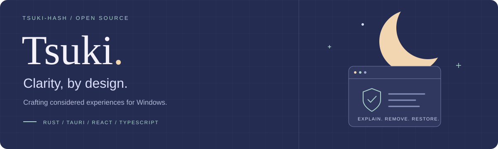

  

<h3 align="center">Complexity, made clear.</h3>

  Building <a href="https://github.com/Tsuki-hash/Remova">Remova</a> — an evidence-driven uninstaller for Windows.

  <a href="https://github.com/Tsuki-hash/Remova">Remova</a> ·
  <a href="https://github.com/Tsuki-hash?tab=repositories">All repositories</a>

---

### Selected work

<table>
  <tr>
    <td width="100%" valign="top">
      <h3><a href="https://github.com/Tsuki-hash/Remova">Remova ↗</a></h3>
      
<strong>Every cleanup, backed by evidence.</strong>

      
A deep uninstaller for Windows. Find leftover files, understand why they matter, and back them up with Safety Vault before removal.

      
<code>Evidence</code> <code>Backup</code> <code>Restore</code>

      
<a href="https://github.com/Tsuki-hash/Remova#readme">Explore</a> · <a href="https://github.com/Tsuki-hash/Remova/releases">Download</a> · <a href="https://github.com/Tsuki-hash/Remova/issues">Issues</a>

    </td>
  </tr>
</table>

### Open source

Recent contributions merged upstream:

- [cc-switch](https://github.com/farion1231/cc-switch/pull/8398) — stopped a false "update available" prompt for locally built development versions.
- [tokscale](https://github.com/junhoyeo/tokscale/pull/1432) — split Hermes sessions that span midnight by their logged call timestamps.

### Approach

- **Clarity** — Give decisions context. Make every cleanup easy to understand.
- **Restraint** — Keep the path short and the interface focused on the task.
- **Care** — Refine the details, from backup and recovery to compatibility and interaction.

**Built with** &nbsp; `Rust` · `Tauri` · `React` · `TypeScript`

---

  Ideas, questions, or a bug to report? Let's talk in the project's Issues. 
  Clarity, by design.

